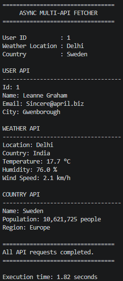

# Async Multi-API Fetcher

[](https://github.com/RebyTK/async-api-fetcher/actions/workflows/ci.yml)
[](https://www.python.org/)
[](https://opensource.org/licenses/MIT)

An asynchronous Python command-line application that retrieves user, current weather, and country information from three public APIs concurrently.

The project demonstrates practical API integration with **HTTPX**, **asyncio**, and **Pydantic**, alongside retry handling, file-based caching, environment-based configuration, automated tests, logging, and performance benchmarking.

## Features

- **Asynchronous HTTP requests:** Uses HTTPX `AsyncClient` for non-blocking API calls.
- **Concurrent API execution:** Fetches user, weather, and country data with `asyncio.gather()`.
- **Retry handling:** Retries transient network errors and selected HTTP status codes with exponential backoff.
- **Response validation:** Validates normalized API responses with Pydantic models.
- **File-based caching:** Stores JSON responses locally and expires entries according to configurable TTL values.
- **Cache control:** Use `--no-cache` to bypass cache reads and writes for a run.
- **Environment-based configuration:** Configure timeouts, retry attempts, and cache TTLs through a `.env` file.
- **Logging:** Records API activity, cache hits and misses, retries, and failures.
- **Automated tests:** Uses pytest and pytest-asyncio to test cache behavior, retries, concurrency, configuration, models, and services.
- **Performance benchmarking:** Compares sequential and concurrent API execution using repeated runs, medians, and averages.
- **Continuous integration:** GitHub Actions runs the test suite and Ruff lint checks on pushes and pull requests targeting `main`.

## APIs

| API | Purpose | Data retrieved |
|---|---|---|
| [JSONPlaceholder](https://jsonplaceholder.typicode.com/) | User information | ID, name, email, city |
| [Open-Meteo](https://open-meteo.com/) | Current weather | Location, country, temperature, humidity, wind speed |
| [REST Countries](https://restcountries.com/) | Country information | Common name, population, region |

The weather service first uses Open-Meteo geocoding to resolve a city name to coordinates, then requests current weather for those coordinates.

## Tech stack

- Python 3.12+
- [uv](https://docs.astral.sh/uv/)
- [HTTPX](https://www.python-httpx.org/)
- asyncio
- [Pydantic](https://docs.pydantic.dev/)
- [pydantic-settings](https://docs.pydantic.dev/latest/concepts/pydantic_settings/)
- [pytest](https://docs.pytest.org/) and pytest-asyncio
- [Ruff](https://docs.astral.sh/ruff/)
- GitHub Actions

## Project structure

```text
async-api-fetcher/
├── .github/
│   └── workflows/
│       └── ci.yml
├── src/
│   └── async_api_fetcher/
│       ├── __init__.py
│       ├── benchmark.py
│       ├── cache.py
│       ├── cli.py
│       ├── config.py
│       ├── logger.py
│       ├── main.py
│       ├── models.py
│       └── services.py
├── test/
│   ├── test_cache.py
│   ├── test_cache_control.py
│   ├── test_concurrency.py
│   ├── test_config.py
│   ├── test_models.py
│   ├── test_retries.py
│   └── test_services.py
├── .env.example
├── .gitignore
├── .python-version
├── LICENSE
├── pyproject.toml
├── README.md
└── uv.lock
```

## Getting started

### Prerequisites

- Python 3.12 or later
- Git
- uv

### 1. Clone the repository

```bash
git clone https://github.com/RebyTK/async-api-fetcher.git
cd async-api-fetcher
```

### 2. Install dependencies

```bash
uv sync --all-groups
```

This installs the project and its development dependencies from the project configuration and lockfile.

### 3. Configure environment variables

The application reads configuration from environment variables and an optional local `.env` file.

Create your local environment file:

**PowerShell**
```powershell
Copy-Item .env.example .env
```

**macOS / Linux**
```bash
cp .env.example .env
```

Set the following values in `.env` (the values below are the application's defaults):

```dotenv
HTTP_TIMEOUT=15.0
MAX_RETRIES=3

USER_TTL=3600
WEATHER_TTL=300
COUNTRY_TTL=86400
```

| Variable | Default | Description |
|---|---:|---|
| `HTTP_TIMEOUT` | `15.0` | HTTP request timeout in seconds |
| `MAX_RETRIES` | `3` | Maximum attempts for a request |
| `USER_TTL` | `3600` | User cache lifetime in seconds (1 hour) |
| `WEATHER_TTL` | `300` | Weather cache lifetime in seconds (5 minutes) |
| `COUNTRY_TTL` | `86400` | Country cache lifetime in seconds (24 hours) |

The REST Countries integration also reads an optional `REST_COUNTRIES_API_KEY` environment variable. If you have a key, set it in your local `.env` file. The application currently has a demo-key fallback when this variable is not set.

**Do not commit your `.env` file or real API credentials.** The repository's `.gitignore` excludes local environment files and generated cache data.

## Usage

Run the CLI with a user ID, weather location, and country:

```bash
uv run async-api-fetcher --user-id 1 --weather-location Delhi --country Sweden
```

The three API requests are started concurrently. Results are displayed independently, so a failure from one API does not prevent the other results from being displayed.

### Disable caching

Use `--no-cache` to fetch fresh data without reading from or writing to the local cache:

```bash
uv run async-api-fetcher --user-id 1 --weather-location Delhi --country Sweden --no-cache
```

### CLI arguments

| Argument | Required | Description |
|---|---|---|
| `--user-id` | Yes | Positive JSONPlaceholder user ID |
| `--weather-location` | Yes | City name used to look up current weather |
| `--country` | Yes | Country name to look up |
| `--no-cache` | No | Bypass cache reads and writes |

For names containing spaces, quote the value:

```bash
uv run async-api-fetcher --user-id 2 --weather-location "New York" --country "United States"
```

## Caching

API results are stored as JSON files in the local `cache/` directory. Cache entries include their creation time and TTL. Expired or invalid cache entries are treated as misses and removed when possible.

Default cache lifetimes:

- User data: 1 hour
- Weather data: 5 minutes
- Country data: 24 hours

Use `--no-cache` when you want to bypass the cache for a particular CLI run. Cache files are local generated data and are not tracked by Git.

## Retry behavior

The shared HTTP helper retries transient network failures and selected HTTP responses:

- HTTP 429
- HTTP 500
- HTTP 502
- HTTP 503
- HTTP 504

Retries use exponential backoff. Other HTTP errors, such as 404, are not retried because repeating a request for a resource that does not exist is unlikely to help. Invalid JSON responses are also treated as errors rather than retried.

The maximum number of attempts is configurable through `MAX_RETRIES`.

## Configuration and validation

Application settings are managed with Pydantic Settings. API responses are normalized into the following Pydantic models before they are returned:

- `UserResponse`
- `WeatherResponse`
- `CountryResponse`

This keeps the output structure consistent and catches unexpected response data early.

## Running tests and quality checks

Run the test suite:

```bash
uv run --locked pytest -v
```

Run Ruff lint checks:

```bash
uv run ruff check src test
```

Check formatting:

```bash
uv run ruff format --check src test
```

Apply formatting when needed:

```bash
uv run ruff format src test
```

## Performance benchmark

The benchmark runs the same three API operations sequentially and concurrently over multiple runs, then reports median and average execution times and the median speedup.

Run it from the repository root:

```bash
uv run python -m async_api_fetcher.benchmark
```

Benchmark results depend on network conditions, API response times, and cache state. The benchmark clears the relevant application cache entries before each measured run; it is intended as an illustrative comparison, not a guaranteed performance result.

## Continuous integration

The GitHub Actions workflow is located at `.github/workflows/ci.yml`.

It runs when code is pushed to `main`, when a pull request targets `main`, or when manually dispatched. The current workflow:

1. Checks out the repository.
2. Sets up Python 3.12 and uv.
3. Installs locked project and development dependencies.
4. Runs the pytest suite.
5. Runs Ruff lint checks on `src` and `test`.

[View CI workflow runs](https://github.com/RebyTK/async-api-fetcher/actions).

## Contributing

Contributions and suggestions are welcome.

1. Fork the repository.
2. Create a feature branch.
3. Make your changes and add or update tests.
4. Run pytest and Ruff locally.
5. Open a pull request against `main`.

## Application Demo

The Async Multi-API Fetcher retrieves user, weather, and country information concurrently through a single CLI command.

### CLI Output



## License

This project is licensed under the [MIT License](LICENSE).
